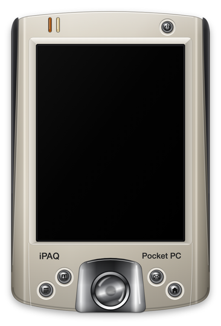
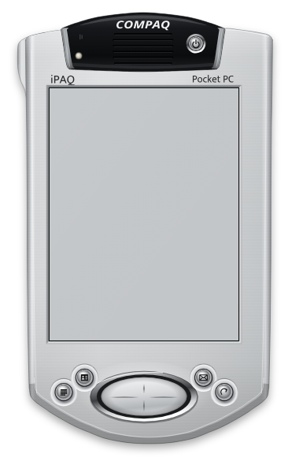
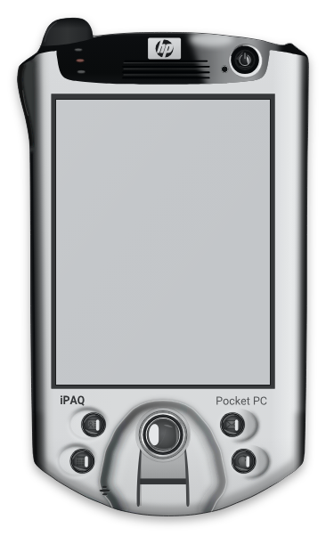
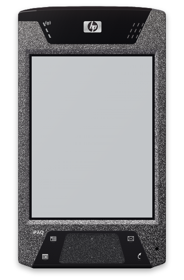
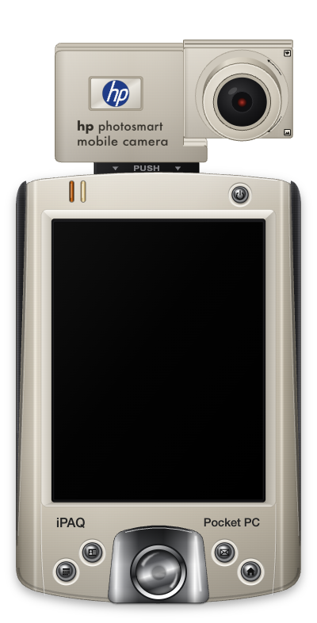

# ipaq-files

Vector front views of HP and Compaq iPAQ handhelds, used as frames around screenshots in the documentation of picowl, picoUI, picoplayer and the other pico* projects. Each drawing is an SVG with a rectangle `id="screen"` where the screenshot goes, plus the script that generated it.

| Device | Drawing | Preview | Glass in the SVG | Screen |
|---|---|---|---|---|
| iPAQ h2200 | [h2200/ipaq-h2200.svg](h2200/ipaq-h2200.svg) |  | x=137.5 y=168 525 x 700 | 240x320 |
| iPAQ h3900 | [h3900/h3900-framed-template.svg](h3900/h3900-framed-template.svg) |  | x=137.5 y=244.75 525 x 700 | 240x320 |
| iPAQ h5550 | [h5550/h5550-framed-template.svg](h5550/h5550-framed-template.svg) |  | x=137.5 y=244.75 525 x 700 | 240x320 |
| iPAQ hx4700 | [hx4700/hx4700-framed-template.svg](hx4700/hx4700-framed-template.svg) |  | x=137.5 y=244.75 525 x 700 | 480x640 |
| iPAQ h2200 with the HP Photosmart Mobile Camera | [hp-photosmart-camera/on-h2200.svg](hp-photosmart-camera/on-h2200.svg) |  | x=137.5 y=168 525 x 700 | 240x320 |

The h3900 and h5550 share a body outline (same width, same expansion sleeves). The glass is 3:4 in every file; the 240x320 files use 2.1875 units per pixel and the hx4700 1.09375.

## Using a frame

Put the screenshot in the glass rectangle, for example as an `<image>` element with the rectangle's position and size, and draw it before the bezel highlights if you need the reflection on top. The SVGs contain no external references.

## Regenerating

The generators write the SVG to the file named on the command line:

```
IPAQ_FONTS=/usr/share/fonts/truetype/ python3 h5550/gen_h5550_final3.py out.svg
```

They need Python 3 with fontTools and these fonts in `IPAQ_FONTS` (default `/Library/Fonts/`): Mukta_Regular, OpenSans_Bold, OpenSans_BoldItalic, Roboto_Bold, Roboto_Regular. The printed marks (iPAQ, Pocket PC, COMPAQ) are converted to glyph outlines in the SVG, so the fonts are only needed to regenerate. The output is byte for byte the committed SVG when the same font files are used. The generators measure positions on reference photographs (rectified so the glass is an upright 3:4 rectangle); the photographs are not part of this repository, and nothing from them is copied into the drawings. `notes.md` in each directory lists the measurements and the decisions made.

The h2200 drawing was written by hand and has no generator.

## The camera

`hp-photosmart-camera/` has the HP Photosmart Mobile Camera that plugs into the SD slot of the h2200: front, back-of-head, from-above and an animated swivel (the head with its lens barrel turning), plus the h2200 frame with the camera clipped on (`on-h2200.svg`, and `on-h2200-swivel.svg`) for screenshots of camera and recorder programs. `notes.md` there describes the files, the axis of the swivel and the measurements.

## Credits

| What | Source | Licence |
|---|---|---|
| hx4700 reference photograph (geometry measured, nothing traced) | "HP iPAQ hx4700 - Front.jpg" by Beamish4, Wikimedia Commons | CC BY-SA 4.0 |
| h2200, h3900 and h5550 references | the author's own devices and photographs | not distributed |
| Glyph outlines: Mukta | Ek Type | SIL OFL 1.1 |
| Glyph outlines: Open Sans | Steve Matteson | SIL OFL 1.1 |
| Glyph outlines: Roboto | Google | Apache-2.0 |

HP, Compaq, iPAQ and Pocket PC are trademarks of their owners and appear only to identify the devices.

## Licence

The drawings are CC-BY-SA-4.0; the scripts are GPL-2.0-or-later. The texts are in `LICENSES/`, and `REUSE.toml` assigns them per file.
