# iPAQ and Zaurus SVG frames

Photo-based SVG frames for placing screenshots in HP iPAQ and Sharp Zaurus devices. Device SVGs mark the display with `rect#screen`. The SVGs are self-contained and can be used as compositing layers or interactive targets in a simulator.

Previews use a consistent approximate physical scale. Click a preview to open its SVG.

<table>
<thead><tr><th>Device</th><th>Standard view</th><th>Keyboard view</th><th>Camera</th><th>Display</th></tr></thead>
<tbody>
<tr valign="top"><td>iPAQ h2200</td><td><a href="h2200/ipaq-h2200.svg"></a></td><td><a href="accesoires/h2200-keyboard/h2200-keyboard.svg"></a></td><td><a href="accesoires/hp-photosmart-camera/hp-photosmart-camera.svg"></a></td><td>240 × 320</td></tr>
<tr valign="top"><td>iPAQ h3900</td><td><a href="h3900/h3900-framed-template.svg"></a></td><td><a href="accesoires/ipaq-keyboard-sleeve/ipaq-keyboard-sleeve.svg">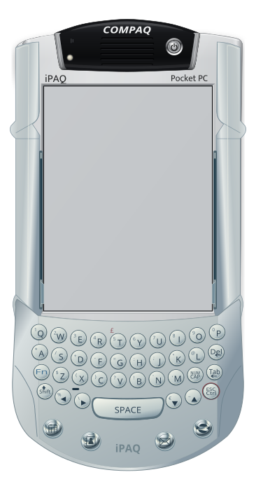</a></td><td><a href="accesoires/hp-photosmart-camera/hp-photosmart-camera.svg">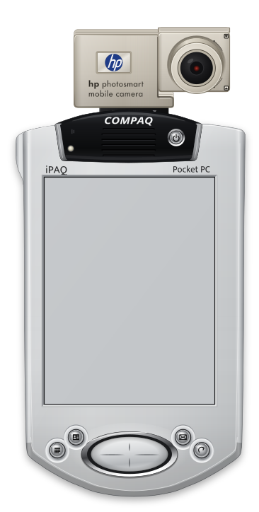</a></td><td>240 × 320</td></tr>
<tr valign="top"><td>iPAQ h5550</td><td><a href="h5550/h5550-framed-template.svg">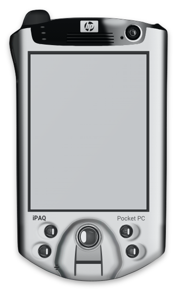</a></td><td><a href="accesoires/ipaq-keyboard-sleeve/ipaq-keyboard-sleeve.svg">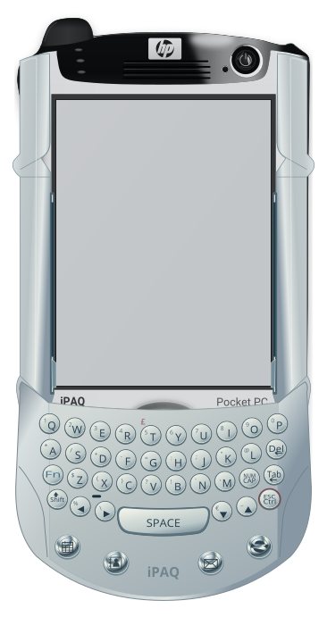</a></td><td><a href="accesoires/hp-photosmart-camera/hp-photosmart-camera.svg">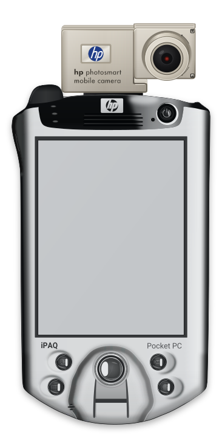</a></td><td>240 × 320</td></tr>
<tr valign="top"><td>iPAQ hx2700</td><td><a href="hx2700/hx2700-framed-template.svg">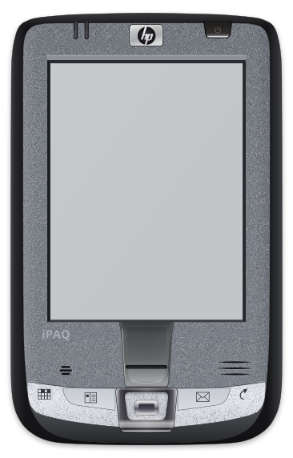</a></td><td></td><td><a href="accesoires/hp-photosmart-camera/hp-photosmart-camera.svg">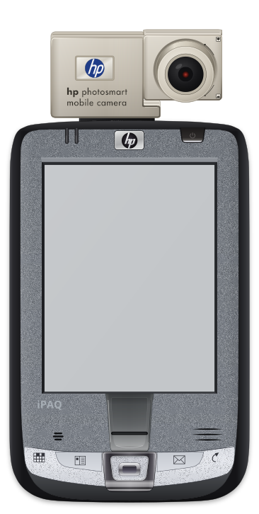</a></td><td>240 × 320</td></tr>
<tr valign="top"><td>iPAQ hx4700</td><td><a href="hx4700/hx4700-framed-template.svg"></a></td><td></td><td><a href="accesoires/hp-photosmart-camera/hp-photosmart-camera.svg">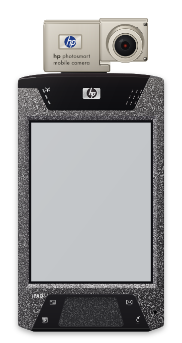</a></td><td>480 × 640</td></tr>
<tr valign="top"><td>Zaurus SL-5500 (Collie)</td><td><a href="sl-5500/sl-5500-framed-template.svg"></a></td><td><a href="sl-5500/sl-5500-framed-template.svg#open"></a></td><td><a href="accesoires/hp-photosmart-camera/hp-photosmart-camera.svg">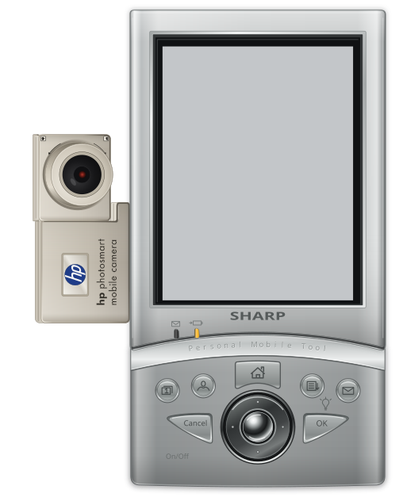</a></td><td>240 × 320</td></tr>
<tr valign="top"><td>Zaurus SL-5600 (Poodle)</td><td><a href="sl-5600/sl-5600-framed-template.svg"></a></td><td><a href="sl-5600/sl-5600-framed-template.svg#open">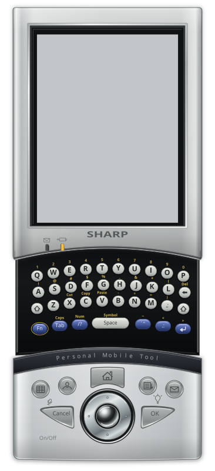</a></td><td><a href="accesoires/hp-photosmart-camera/hp-photosmart-camera.svg">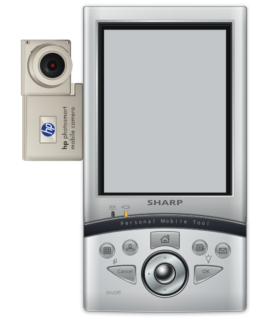</a></td><td>240 × 320</td></tr>
<tr valign="top"><td>Zaurus SL-6000 (Tosa)</td><td><a href="sl-6000/sl-6000-framed-template.svg">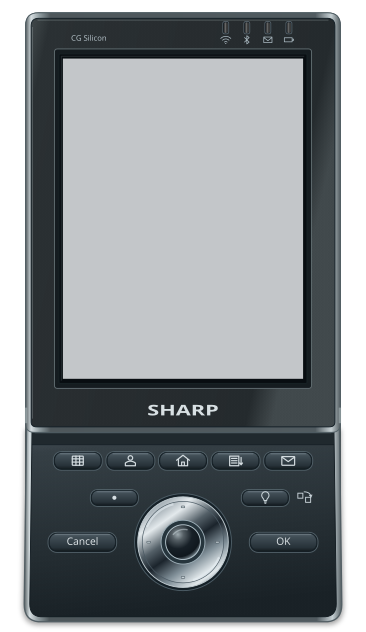</a></td><td><a href="sl-6000/sl-6000-framed-template.svg#open">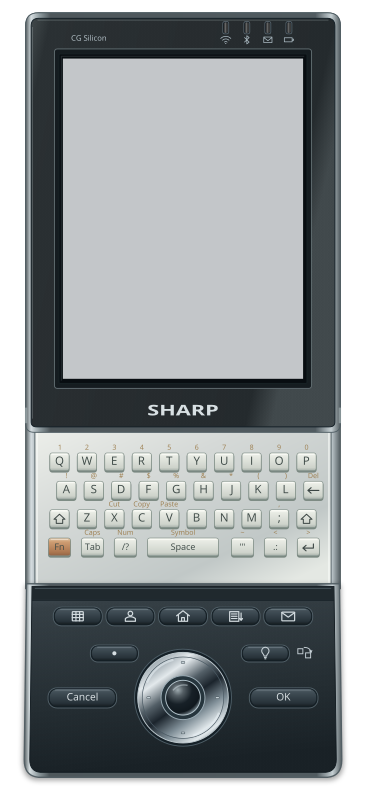</a></td><td><a href="accesoires/hp-photosmart-camera/hp-photosmart-camera.svg">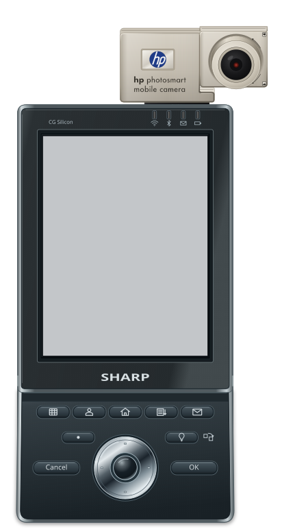</a></td><td>480 × 640</td></tr>
<tr valign="top"><td>Zaurus SL-C700</td><td><a href="sl-c700/sl-c700-pda.svg"></a></td><td><a href="sl-c700/sl-c700-laptop.svg"></a></td><td><a href="accesoires/hp-photosmart-camera/hp-photosmart-camera.svg">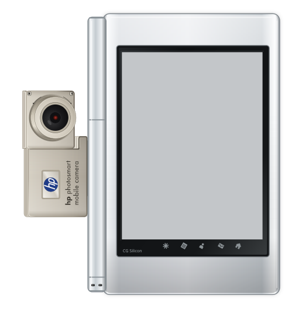</a></td><td>480 × 640 folded<br>640 × 480 laptop</td></tr>
</tbody>
</table>

## Add a screenshot

Replace `#screen` with an SVG image element using the same geometry. For an inline SVG, a PNG data URL works across browsers:

```js
const screen = document.querySelector("#collie #screen");
const image = document.createElementNS("http://www.w3.org/2000/svg", "image");
for (const name of ["id", "x", "y", "width", "height"]) {
  image.setAttribute(name, screen.getAttribute(name));
}
image.setAttribute("href", screenshotDataUrl);
image.style.imageRendering = "pixelated";
screen.replaceWith(image);
```

Use `#poodle`, `#tosa`, `#c700-laptop` or `#c700-pda` in place of `#collie` for those inline SVGs. For a linked SVG, use a data URL for the screenshot if the browser blocks external images. The frame's viewBox preserves its proportions; set an explicit width or height when embedding it.

## Controls and LEDs

Controls are SVG hit targets, not built-in simulation logic. Examples include `button-up`, `button-select`, `key-q` and `key-space`. Zaurus slider controls can be activated in a browser or `<object>`; `#open` selects the open view in static image contexts. To start in the open position in renderers that ignore fragment views, generate the `--keyboard` variant.

LEDs are individual SVG elements. Set their `fill` to change state or colour; restore the initial `fill` to turn a light off.

| Frame | LED IDs |
|---|---|
| SL-5500, SL-5600 | `led-mail`, `led-charge` |
| SL-6000 | `led-mail`, `led-charge`, `led-wlan`, `led-bluetooth` |
| iPAQ h2200 | `led-bluetooth`, `led-power` |
| iPAQ h3900 | `led-bluetooth` (h3970 light pipe), `led-power` |
| iPAQ h5550 | `led-power`, `led-bluetooth`, `led-wlan` |
| iPAQ hx2700 | `led-radio`, `led-charge` |
| iPAQ hx4700 | `led-wireless`, `led-notification`, `led-power` |
| Zaurus SL-C700 | `led-mail`, `led-charge` |

Accessory LED IDs, where present, are `led-power` and `led-active` on the Buffalo card, `led-link` on the SanDisk card, and `led-status` on the keyboard sleeve.

## Accessories

The SVGs in `accesoires/` include CF cards, two iPAQ expansion sleeves, the HP Photosmart camera and an h2200 thumb keyboard. Accessory drawings have transparent backgrounds for compositing.

<table>
<thead><tr><th>Accessory</th><th>Preview</th><th>Interface</th></tr></thead>
<tbody>
<tr valign="top"><td><a href="accesoires/buffalo-wli-cf-s11g/buffalo-wli-cf-s11g.svg">Buffalo AirStation WLI-CF-S11G</a></td><td>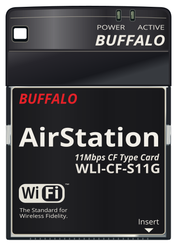</td><td>CompactFlash</td></tr>
<tr valign="top"><td><a href="accesoires/asus-wl110/asus-wl110.svg">ASUS SpaceLink WL-110</a></td><td>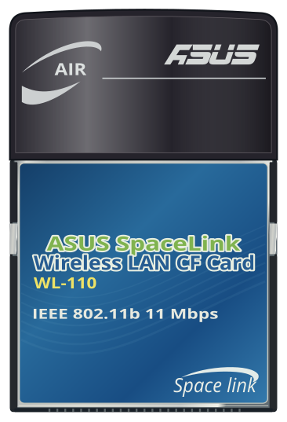</td><td>CompactFlash</td></tr>
<tr valign="top"><td><a href="accesoires/sandisk-connectplus/sandisk-connectplus.svg">SanDisk ConnectPlus 128 MB</a></td><td>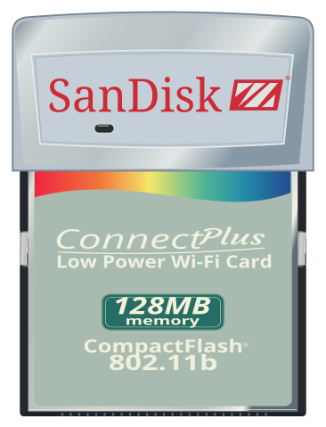</td><td>CompactFlash</td></tr>
<tr valign="top"><td><a href="accesoires/navman-gps-sleeve/navman-gps-sleeve.svg">Navman SE GPS sleeve</a></td><td>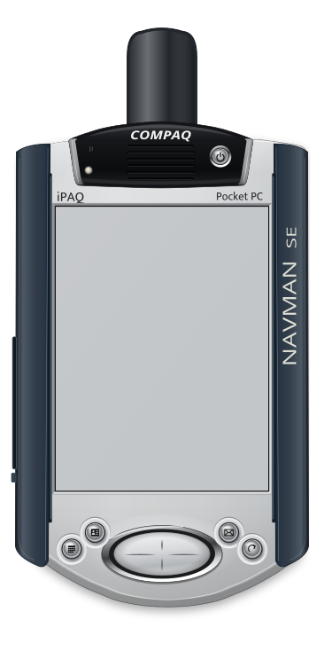</td><td>iPAQ expansion sleeve; side CF slot</td></tr>
<tr valign="top"><td><a href="accesoires/ipaq-keyboard-sleeve/ipaq-keyboard-sleeve.svg">iPAQ keyboard sleeve</a></td><td></td><td>iPAQ expansion sleeve</td></tr>
<tr valign="top"><td><a href="accesoires/hp-photosmart-camera/hp-photosmart-camera.svg">HP Photosmart Mobile Camera</a></td><td>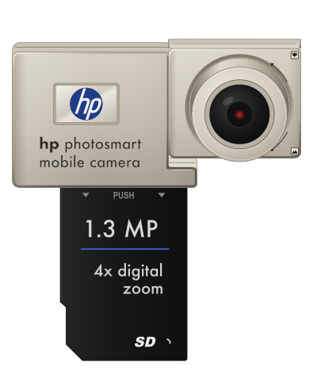</td><td>SDIO</td></tr>
<tr valign="top"><td><a href="accesoires/h2200-keyboard/h2200-keyboard.svg">iPAQ h2200 thumb keyboard</a></td><td></td><td>h2200 only</td></tr>
</tbody>
</table>

The previews show the measured h3900/Navman and h5550/keyboard pairings. Composed views are available for both sleeves on either the h3900 or h5550.

`accesoires/compatibility.json` describes physical interfaces. Use `--compatible` to list attachable accessories; `--with-accessory` adds an accessory's capabilities when checking combinations:

```sh
python3 generate.py --compatible h2200
python3 generate.py --compatible h3900 --with-accessory navman-gps-sleeve
python3 generate.py --compatible h5550 --with-accessory cf-sleeve
```

The Navman sleeve provides a CF slot. A generic `cf-sleeve` compatibility entry is available for sleeve-capable iPAQs without a separate drawing.

## Composed variants

Generate a Zaurus with its keyboard open, compose the h2200 keyboard, or place a sleeve around an iPAQ:

```sh
python3 generate.py sl-5500 --keyboard
python3 generate.py h2200 --keyboard
python3 generate.py h3900 --sleeve navman-gps-sleeve
python3 generate.py h5550 --sleeve ipaq-keyboard-sleeve
```

`--keyboard` opens the SL-5500, SL-5600 and SL-6000 sliders, selects the C700 laptop view, or composes the h2200 keyboard. `--sleeve` accepts `navman-gps-sleeve` or `ipaq-keyboard-sleeve` and supports the h3900 and h5550. `all` selects every model supported by the chosen variant.

The standalone h2200 keyboard drawing uses h2200 frame coordinates and can be overlaid without a transform. The standalone sleeves, camera and CF cards can likewise be composed by an application or SVG tool.

The Photosmart camera has front, away-facing, elevated and animated swivel drawings. Compose a camera onto a device with `--camera front`, `--camera away` or `--camera swivel`; `all --camera front` generates variants for supported devices. Camera placement follows the device's SD slot. The C700 laptop's display and hinge obscure a camera at the rear edge.

## Generate and validate

Python 3.8+ and `fontTools` are required for artwork generation. Fonts are read from `/Library/Fonts` by default; set `IPAQ_FONTS` or use `--fonts DIR` to choose another directory.

```sh
python3 generate.py --list
python3 generate.py all --output-dir out
python3 generate.py sl-c700                 # both C700 views
python3 generate.py camera                  # standalone camera views
python3 generate.py accessories             # cards, sleeves and h2200 keyboard
python3 generate.py all --check              # compare generated SVGs without writing
python3 -m unittest -v test_generate
```

`--output-dir` preserves the repository's directory structure. `--output FILE.svg` writes one selected view to an exact path. `--check` compares generated SVGs with the files on disk without changing them. The generator validates each output before writing.

Previews are PNG files and are not regenerated by `generate.py`. To render an SVG with [librsvg](https://gitlab.gnome.org/GNOME/librsvg), use `rsvg-convert`.

## Sources and licences

| Artwork | Reference |
|---|---|
| iPAQ h2200, h3900, h5550, Collie and C700 | The author's devices and photographs |
| iPAQ hx2700 | [HP iPAQ hx2110 photographs](https://commons.wikimedia.org/wiki/Category:HP_iPAQ_hx2110), Yuri Litvinenko |
| iPAQ hx4700 | [HP iPAQ hx4700 - Front.jpg](https://commons.wikimedia.org/wiki/File:HP_iPAQ_hx4700_-_Front.jpg), Beamish4 |
| Zaurus SL-5500 | [Sharp Zaurus SL-5500G.jpg](https://commons.wikimedia.org/wiki/File:Sharp_Zaurus_SL-5500G.jpg), Wusel007 |
| Zaurus SL-5600 | [Wayne Sadler](https://www.flickr.com/photos/dronecatcher/51187902024/) and [VickyKenKiyomi](https://www.flickr.com/photos/vickyken/3484833409/) |
| Zaurus SL-6000 | [Sharp product catalogue](https://jp.sharp/products/sl6000/) and [Roberto Innocenti](https://www.flickr.com/photos/12161791@N00/792844922/) |
| Zaurus SL-C700 | [Sharp Zaurus SL-C700.jpg](https://commons.wikimedia.org/wiki/File:Sharp_Zaurus_SL-C700.jpg), ポリンキ; [HPC.ru review](https://hpc.ru/lib/arts/1927/) |
| HP Photosmart camera | [HP PhotoSmart SDIO Kamera.jpg](https://commons.wikimedia.org/wiki/File:HP_PhotoSmart_SDIO_Kamera.jpg), Afrank99 |

Third-party reference photographs are not included in this repository. Device names and marks identify the depicted products.

The SVG drawings are licensed under [CC BY-SA 4.0](LICENSES/CC-BY-SA-4.0.txt). The scripts are licensed under [GPL-2.0-or-later](LICENSES/GPL-2.0-or-later.txt). Font-derived outlines use Mukta, Open Sans, Noto Sans CJK JP and Roboto under their respective font licences; see `REUSE.toml`.
