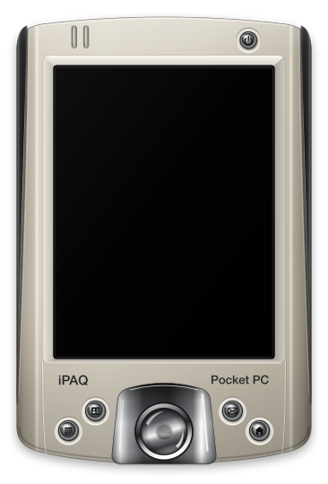
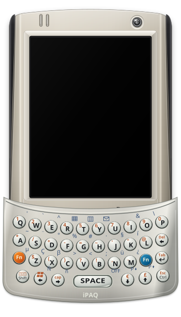
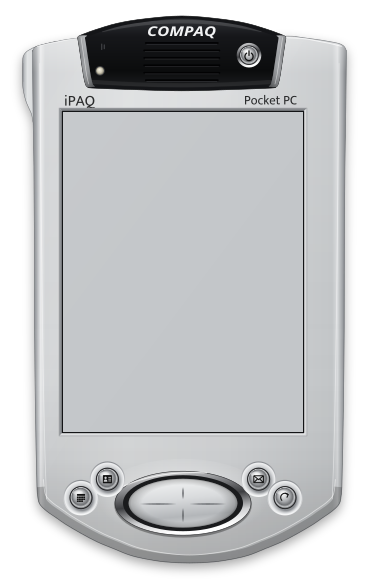
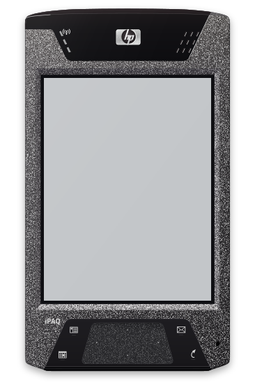
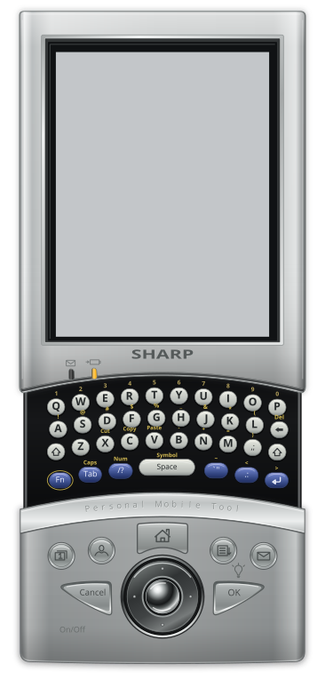
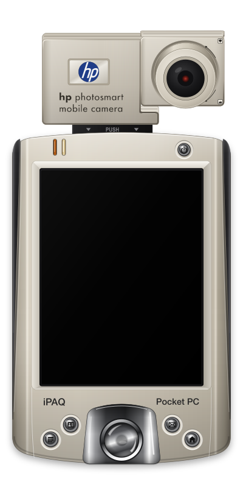

# ipaq-files

Vector front views of HP and Compaq iPAQ and Sharp Zaurus handhelds, used as frames around screenshots in the documentation of picowl, picoUI, picoplayer and the other pico* projects. Each SVG has a rectangle `id="screen"` where the screenshot goes.

| Device | Drawing | Preview | Glass in the SVG | Screen |
|---|---|---|---|---|
| iPAQ h2200 | [h2200/ipaq-h2200.svg](h2200/ipaq-h2200.svg) |  | x=137.5 y=168 525 x 700 | 240x320 |
| iPAQ h2200 with thumb keyboard | [h2200/ipaq-h2200-keyboard.svg](h2200/ipaq-h2200-keyboard.svg) |  | x=137.5 y=168 525 x 700 | 240x320 |
| iPAQ h3900 | [h3900/h3900-framed-template.svg](h3900/h3900-framed-template.svg) |  | x=137.5 y=244.75 525 x 700 | 240x320 |
| iPAQ h5550 | [h5550/h5550-framed-template.svg](h5550/h5550-framed-template.svg) |  | x=137.5 y=244.75 525 x 700 | 240x320 |
| iPAQ hx4700 | [hx4700/hx4700-framed-template.svg](hx4700/hx4700-framed-template.svg) |  | x=137.5 y=244.75 525 x 700 | 480x640 |
| Zaurus SL-5500 (Collie) | [sl-5500/sl-5500-framed-template.svg](sl-5500/sl-5500-framed-template.svg) |   | x=137.5 y=168 525 x 700 | 240x320 |
| Zaurus SL-5600 (Poodle) | [sl-5600/sl-5600-framed-template.svg](sl-5600/sl-5600-framed-template.svg) |   | x=137.5 y=168 525 x 700 | 240x320 |
| Zaurus SL-6000 (Tosa) | [sl-6000/sl-6000-framed-template.svg](sl-6000/sl-6000-framed-template.svg) |   | x=137.5 y=168 525 x 700 | 480x640 |
| Zaurus SL-C700, laptop | [sl-c700/sl-c700-laptop.svg](sl-c700/sl-c700-laptop.svg) |  | x=255 y=92 700 x 525 | 640x480 |
| Zaurus SL-C700, folded | [sl-c700/sl-c700-pda.svg](sl-c700/sl-c700-pda.svg) |  | x=165 y=195 525 x 700 | 480x640 |
| iPAQ h2200 with the HP Photosmart Mobile Camera | [hp-photosmart-camera/on-h2200.svg](hp-photosmart-camera/on-h2200.svg) |  | x=137.5 y=168 525 x 700 | 240x320 |

The h3900 and h5550 share a body outline (same width, same expansion sleeves). The 240x320 screens use 2.1875 units per pixel; the VGA screens use 1.09375.

The h2200 and Zaurus frames have no fixed display dimensions and scale to the browser window. Set an explicit width when embedding them if needed; the viewBox preserves their proportions.

## Using a frame

Put the screenshot in the glass rectangle, for example as an `<image>` element with the rectangle's position and size, and draw it before the bezel highlights if you need the reflection on top. The SVGs contain no external references.

For the inline Collie SVG, replace the rectangle with an image, keeping its ID and geometry. Use `#poodle` instead of `#collie` for the SL-5600. Here `screenshotDataUrl` is a PNG data URL supplied by the application:

```js
const glass = document.querySelector("#collie #screen");
const image = document.createElementNS("http://www.w3.org/2000/svg", "image");
for (const name of ["id", "x", "y", "width", "height"]) image.setAttribute(name, glass.getAttribute(name));
image.setAttribute("href", screenshotDataUrl);
glass.replaceWith(image);
```

Browsers can block linked images inside an SVG used as an ``; use a data URL there. Set `image.style.imageRendering = "pixelated"` for sharp low-resolution captures. All three sliding Zaurus frames use the same glass coordinates as the h2200 frame in picoDoom; the SL-6000 uses a 480x640 capture.

## Sliding keyboards and controls

The SL-5500, SL-5600 and SL-6000 SVGs default to the closed position. Append `#open` to the SVG path for the open view in an ``, or load the SVG in a browser or `<object>` and click or keyboard-activate the slider strip to toggle it. An `` is not interactive.

For an interactive `<object>`, reserve the open height, for example `<object type="image/svg+xml" data="sl-5500/sl-5500-framed-template.svg" width="320" height="668"></object>`. At the same width, use height `700` for the SL-5600 or `688` for the SL-6000. The closed view leaves blank space below the device; the screen stays in the same position in both views. A same-origin application can attach handlers through `object.contentDocument`.

For an inline SVG without a `#open` page fragment, handle the strip links without navigating the page. Select `#poodle` or `#tosa` instead of `#collie` for the other sliders:

```js
const frame = document.querySelector("#collie");
for (const open of [true, false]) {
  frame.querySelector(open ? "#open-keyboard" : "#close-keyboard").addEventListener("click", event => {
    event.preventDefault();
    frame.setAttribute("data-keyboard", open ? "open" : "closed");
    frame.setAttribute("viewBox", frame.querySelector(open ? "#open" : "#closed").getAttribute("viewBox"));
  });
}
```

Controls have IDs such as `button-up`, `button-select`, `button-home`, `key-q` and `key-space`; they are hit targets, not built-in simulation logic.

Set the `fill` of `#led-mail` or `#led-charge` to change its colour, for example `frame.querySelector("#led-mail").setAttribute("fill", "#36d966")`. Use `#252626` for off; the SL-5500 and SL-5600 charge light defaults to `#ffb823`. The SL-6000 also has `#led-wlan` and `#led-bluetooth`, with all four off initially. The lens shading stays in place.

The iPAQ frames expose their status lights the same way, all unlit initially. To switch one off again, restore the `fill` it had when the SVG loaded:

| Device | LEDs | Unlit fill | Source |
|---|---|---|---|
| h2200 | `led-bluetooth` (left), `led-power` (right) | `#b8b2a5` | [HP QuickSpecs, items 8 and 9](https://www.manualslib.com/manual/661575/Hp-Ipaq-H2200-Series.html) and the owner's photograph |
| h3900 | `led-bluetooth` (left light pipe, h3970 only), `led-power` (right, beside the power button) | `#8e9195` | [HP Getting Started, page 8](https://www.manualslib.com/manual/359385/Hp-Ipaq-H3900.html?page=8) |
| h5550 | `led-power` (beside the power button); `led-bluetooth` and `led-wlan` (left column, below `light-sensor`) | `#121315`, `#2a2b2d` | [HP Getting Started](https://www.manualslib.com/manual/277300/Hp-Ipaq-H5100.html) and ["HP Ipaq 5550.jpg"](https://commons.wikimedia.org/wiki/File:HP_Ipaq_5550.jpg) |
| hx4700 | `led-wireless` (top), `led-notification`, `led-power` | `#a1a2a4` | [HP User's Guide, printed 8-2](https://www.manualslib.com/manual/72007/Hp-Ipaq-Hx4700.html?page=100) |

HP documents amber flashing for charging, solid amber for charged and green flashing for alarms on the power lights. Bluetooth is blue on all four; the h5550 WLAN light flashes green with a link and amber without; the hx4700 wireless light is solid blue for Wi-Fi or Bluetooth. The order of the h5550 left column and of the two lower hx4700 lights follows HP's callout sequence and is unverified, because no photograph found shows them lit.

Some static SVG renderers ignore fragment views or CSS transforms. To export the open view with those tools, set `viewBox="0 40 800 1670"` on a Collie copy and `transform="translate(0 290)"` on its `<g id="slider">`. For the SL-5600, use `viewBox="0 40 800 1750"` and `transform="translate(0 370)"`; for the SL-6000, use `viewBox="0 40 800 1720"` and `transform="translate(0 340)"`.

The SL-5500 US QWERTY layout follows Sharp's [Start-up Guide](https://archive.org/download/ZaurusSL5500Software/SL5500SUG_Final.pdf); the SL-5600 layout follows photographs. Outlines and slider travel are estimated from screen-rectified photographs, not CAD: the photos imply slightly different body widths, and the brushed finish and ball reflections are simplified.

The black SL-6000 follows Sharp's [product photographs and specifications](https://jp.sharp/products/sl6000/) and [operation manual](https://www.manualslib.com/manual/807955/Sharp-Sl-6000l.html?page=27). Its protective flip cover is omitted. The small left dot-marked button is a second OK control, not a printed Ctrl key. Wireless indicators vary between N/L/W models; the drawing exposes both wireless lights for simulation.

The optional h2200 keyboard follows the owner's attached and detached photographs: 37 domed keys in bowed rows, orange alternate legends and blue casing legends. It covers the lower controls, as the real accessory does, without moving or covering the screen. `addon-keyboard` contains independent `key-*` targets. The original h2200 SVG remains unchanged.

## SL-C700 views and controls

The laptop and folded frames are separate SVGs. Use a landscape 640x480 capture for the laptop, or a portrait 480x640 capture for the folded view. Replace `#screen` as above, selecting `#c700-laptop` or `#c700-pda` instead of `#collie`.

The laptop has `key-*` and `button-*` hit targets; both views have `touch-home`, `touch-mail`, `touch-address`, `touch-calendar` and `touch-clock` for the five touchscreen shortcuts. Set the fill of `#led-mail` or `#led-charge` to recolour the indicators; both default to `#252626` (off). These targets have no built-in simulation logic.

Both views use the same shortcut glyphs, size and ink colour. Their diagonal printing turns 90 degrees with the lid rather than being redrawn upright for each screen orientation.

The key faces and lower controls share one perspective plane; their legends use local affine approximations. The screen stays rectangular for straightforward screenshot placement. Shell proportions, reflections and small printed markings are approximations based on photographs.

## Regenerating

`generate.py` draws the h3900, h5550, hx4700, SL-5500, SL-5600, SL-6000, both C700 views, h2200 keyboard and Photosmart camera from geometry. The h2200 frame is manually maintained: accessory generation reads that SVG without modifying it.

```sh
python3 generate.py --list
python3 generate.py all --output-dir out
python3 generate.py h3900 sl-5600 --output-dir out
python3 generate.py sl-c700 --output-dir out       # both views
python3 generate.py sl-c700-pda --output folded.svg
python3 generate.py sl-6000
python3 generate.py h2200 --keyboard
python3 generate.py sl-6000 --keyboard --camera front --output-dir out
python3 generate.py sl-c700 --keyboard --output-dir out
python3 generate.py all --keyboard --camera swivel --output-dir out
python3 generate.py h2200 --keyboard --camera swivel --output-dir out
python3 generate.py all --camera front --output-dir out
python3 generate.py camera                        # four standalone camera views
python3 generate.py all --check                   # compare committed SVGs, no writes
python3 generate.py camera --check
python3 generate.py h2200 --keyboard --check
python3 generate.py all --check --output-dir out
python3 -m unittest -v test_generate
```

Use Python 3.8+ and [fontTools](https://pypi.org/project/fonttools/) (`python3 -m pip install fonttools` if missing). No NumPy or OpenCV is required. Put the following files directly in `IPAQ_FONTS` (default `/Library/Fonts`), or select a directory with `--fonts DIR`:

| Model | Font files |
|---|---|
| h3900 | `Mukta_Regular.ttf`, `OpenSans_BoldItalic.ttf` |
| h5550 | `Roboto_Bold.ttf`, `Roboto_Regular.ttf` |
| hx4700 | `OpenSans_Bold.ttf` |
| SL-5500, SL-5600, SL-6000, C700 folded, h2200 keyboard | `OpenSans_Regular.ttf`, `OpenSans_Bold.ttf` |
| C700 laptop | `OpenSans_Regular.ttf`, `OpenSans_Bold.ttf`, `NotoSansCJKjp_Regular.otf` |

Fonts are needed only for device and keyboard regeneration; their lettering remains editable vector paths. Camera generation and camera composition onto the manual h2200 need only Python's standard library. The camera retains its small live-text labels, with the SVG's Futura/Avenir/Trebuchet font stack. Using the same font files produces byte-identical committed SVGs. Missing required fonts, glyphs or dependencies are errors, never substitutions. Artwork integration tests explicitly skip when their fonts or fontTools are unavailable; CLI failure and output-validation tests still run.

`--output-dir` preserves the repository's model subdirectories; without it, outputs go beside this script in their usual model directories. `--output` selects one exact `.svg` path and requires a single view. `--check` regenerates and compares exact bytes without writing. Every CLI invocation ends with exactly one `SUCCESS` or `FAILURE` line; failures exit nonzero. All selected drawings are built and checked before writing, staged files are read back, and each destination is replaced atomically and verified. A filesystem failure during final replacement can leave a partially updated batch; a failed run must not be treated as complete. Checks include XML, unique IDs, screen geometry and sliding-frame fragment controls.

`--camera front|away|swivel` writes a `-camera-VIEW.svg` variant rather than overwriting the base frame. For h2200 without the keyboard, the front and swivel views retain `hp-photosmart-camera/on-h2200.svg` and `on-h2200-swivel.svg`. With `--camera`, `all` also includes the manual h2200.

`--keyboard` opens the SL-5500/5600/6000 sliders, selects laptop mode for either C700 view or the `sl-c700` alias, and attaches the h2200 thumb keyboard. It writes `-keyboard.svg` variants; combining flags writes `-keyboard-camera-VIEW.svg`. Open slider variants work in static renderers and retain interactive open/closed fragments. `all --keyboard` selects these five keyboard-capable configurations, skipping iPAQs with no supported keyboard drawing; explicitly selecting an unsupported model is an error.

Custom `--output` paths must not use a protected base or other variant's filename. Accessory canvases expand without changing screen coordinates; use their own `#open` and `#closed` viewBoxes when changing slider state.

The generator does not refresh previews. Existing `rsvg-convert` can render a generated SVG; for static open-keyboard exports, use `--keyboard` instead of fragment URLs. To add a device, write `build_model(fonts) -> str` and add a `Model` entry to `MODELS`; font outlining and output checks are shared.

### Measurement conventions

These are measured front-view approximations, not CAD or traced photographs. References are rectified against the visible screen opening; no photograph is distributed or embedded.

- **h3900:** the owner's front and tape photographs agree within about 1% on a body/opening width near 1.30 (roughly 76–77 mm over a 58.5–59 mm opening), rather than dividing by the smaller active display area. The body is offset right of the screen: centre 591 versus 575 in the 600-pixel-wide rectified-glass coordinates. The left shoulder and record housing are measured separately; the bottom centre is at 1389.6. Mapping uses 0.875 SVG units per photo pixel.
- **h5550:** the same expansion-sleeve body envelope is used, despite the photograph suggesting a wider body. The envelope moves down 41 photo pixels; outside the screen band, vertical spacing scales by about 0.948, while round controls retain their size. The body is approximately 1 mm shorter than the h3900 (published 133 versus 134 mm). The photograph's warm lamp cast is neutralised to silver-grey; the power button is a chrome dome with a power symbol, and the smaller adjacent window is the power indicator, lit in a charging photograph. The hp letters cut through the badge disc.
- **hx4700:** the rectified glass is 1776×2368 photo pixels, mapped at 525/1776 SVG units per pixel. Face-plane features are recentered by 22 photo pixels to remove camera parallax. The body ratio is about 1.71 versus the published 131×77 mm ratio of 1.70. The asymmetric cap, chamfered lower corners and grain are intentional; unreadable small labels are represented by faint marks rather than invented words.

## The camera

`hp-photosmart-camera/` contains front, away-facing, elevated and animated swivel views of the 1.3 MP HP Photosmart Mobile Camera, plus `on-h2200.svg` and `on-h2200-swivel.svg`. The composites extend the viewBox upwards without moving the screen. The SD plug is scaled to 24 mm against the h2200's 71 mm body width.

The head, lens barrel and focus marks rotate together around the horizontal body-to-head axis; the body and plug stay fixed. The 10-second SMIL loop needs no script. Rounded shell corners, inset bevels, the swivel seam and barrel seating replace the sharp box-like transitions. Surfaces, logos and lettering remain simplified; compare the front and elevated views rather than treating them as a CAD reconstruction. Regenerate with `python3 generate.py camera`, then `python3 generate.py h2200 --camera front` or `--camera swivel` for the legacy composites.

Camera placement follows each device's SD slot, not its CompactFlash slot. Slot edges are verified; exact seating coordinates and swivel clearances are estimated from photographs and diagrams.

| Device | SD insertion edge | Reference |
|---|---|---|
| h2200 | top | owner's photograph with the camera attached |
| h3900 | top | [HP QuickSpecs, item 15](https://www.manualslib.com/manual/661584/Hp-Compaq-Ipaq-H3900-Series.html) |
| h5550 | top, near centre, to the right of the WLAN antenna | [HP QuickSpecs, item 18](https://www.manualslib.com/manual/661587/Hp-Ipaq-H5500-Series.html?page=1) |
| hx4700 | top | [HP User's Guide, printed 11-2](https://www.manualslib.com/manual/72007/Hp-Ipaq-Hx4700.html?page=144) |
| SL-5500 | left long edge, around mid-body | [Sharp Start-up Guide, printed 20 and 63](https://archive.org/download/ZaurusSL5500Software/SL5500SUG_Final.pdf) |
| SL-5600 | left long edge, around mid-screen | [Sharp SL-5600 brochure, expansion-slot callout 1](https://web.archive.org/web/20050128181429/http://www.sharpusa.com/files/hpc_dow_SL_5600BRO.pdf) |
| SL-6000 | top, beside CompactFlash | [Sharp Operation Manual, printed 26 and 76](https://www.manualslib.com/manual/807955/Sharp-Sl-6000l.html?page=28) |
| C700 | hinge edge: left when folded, rear when used as a laptop | [HPC.ru review and edge photograph](https://hpc.ru/lib/arts/1927/) |

The laptop C700's display and hinge largely obscure a camera inserted at the rear edge; it is not relocated to a visible but incorrect side. These are physical-placement illustrations, not claims that the Photosmart SDIO camera has working drivers on every device or operating system.

## Credits

| What | Source | Licence |
|---|---|---|
| hx4700 reference photograph (geometry measured, nothing traced) | "HP iPAQ hx4700 - Front.jpg" by Beamish4, Wikimedia Commons | CC BY-SA 4.0 |
| Collie reference photograph (geometry measured, nothing traced) | ["Sharp Zaurus SL-5500G.jpg"](https://commons.wikimedia.org/wiki/File:Sharp_Zaurus_SL-5500G.jpg) by Wusel007, Wikimedia Commons | [CC BY-SA 3.0](https://creativecommons.org/licenses/by-sa/3.0/) |
| SL-5600 reference photographs (geometry measured, nothing traced) | ["Zaurus SL-5600"](https://www.flickr.com/photos/dronecatcher/51187902024/) by Wayne Sadler and ["Sharp Zaurus SL-5600 (poodle)"](https://www.flickr.com/photos/vickyken/3484833409/) by VickyKenKiyomi | reference only, not distributed |
| C700 reference photograph (geometry measured, nothing traced) | ["Sharp Zaurus SL-C700.jpg"](https://commons.wikimedia.org/wiki/File:Sharp_Zaurus_SL-C700.jpg) by ポリンキ, Wikimedia Commons | [CC BY 4.0](https://creativecommons.org/licenses/by/4.0/) |
| C700 reference photographs | [HPC.ru SL-C700 review](https://hpc.ru/lib/arts/1927/) by Vladimir Speransky | reference only, not distributed |
| SL-6000 reference photographs | [Sharp product catalogue](https://jp.sharp/products/sl6000/) and [Roberto Innocenti's photographs](https://www.flickr.com/photos/12161791@N00/792844922/) | reference only, not distributed |
| Photosmart swivel reference (geometry studied, nothing traced) | ["HP PhotoSmart SDIO Kamera.jpg"](https://commons.wikimedia.org/wiki/File:HP_PhotoSmart_SDIO_Kamera.jpg) by Afrank99, Wikimedia Commons | [CC BY-SA 2.0](https://creativecommons.org/licenses/by-sa/2.0/) |
| h2200, its keyboard and camera, h3900, h5550, Collie and C700 keyboard references | the author's own devices and photographs | not distributed |
| Glyph outlines: Mukta | Ek Type | SIL OFL 1.1 |
| Glyph outlines: Open Sans | Steve Matteson | SIL OFL 1.1 |
| Glyph outlines: Noto Sans CJK JP | Google | SIL OFL 1.1 |
| Glyph outlines: Roboto | Google | Apache-2.0 |

HP, Compaq, iPAQ, Pocket PC, Sharp and Zaurus are trademarks of their owners and appear only to identify the devices.

## Licence

The drawings are CC-BY-SA-4.0; the scripts are GPL-2.0-or-later. The texts are in `LICENSES/`, and `REUSE.toml` assigns them per file.
